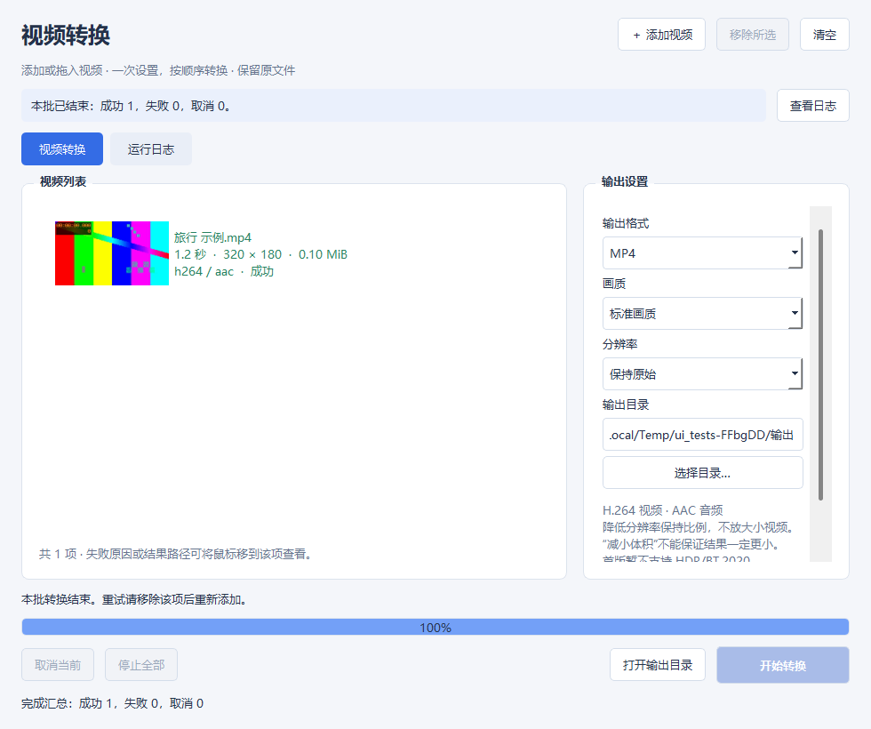

# VideoConversion

面向普通用户的 Windows 桌面视频转换器，使用 C++17、Qt 5.12.12 Widgets 和 FFmpeg。首版实现多文件导入、信息与缩略图、MP4/MKV、统一输出设置、串行队列、真实进度、取消和安全结果保存。

简单说：添加视频，选好画质和输出位置，开始转换；原文件保留，完成后打开目录找结果。



[首版旧布局流程演示](docs/screenshots/流程展示.gif)（由第 1 版测试截图组成，非实时录屏；当前双页签布局见上图和[日志页截图](docs/screenshots/06-converting-log.png)）。

## 使用

1. 解压 Windows 64 位包，运行 `VideoConversion.exe`，保留同目录中的 DLL、`platforms` 和 `tools`。
2. 点击“添加视频”多选文件，或把本地文件拖进窗口。目录和重复路径会提示跳过。
3. 等信息与缩略图读取结束，设置格式、画质、分辨率和输出目录；小窗口可滚动右侧设置。
4. 点击“开始转换”。运行时锁定导入、队列编辑和设置，一个文件失败后继续下一项。
5. “取消当前”清理当前临时结果后继续；“停止全部”取消当前与本批待处理项。
6. 完成后点击“打开输出目录”。结果为 `原名_converted.mp4/mkv`，重名追加 `_1`、`_2` 等，不覆盖已有文件。

每项显示文件名、时长、显示分辨率、大小、编码和状态。默认窗口为 980×820，列表限制最大宽度，长文件名省略显示；将鼠标移到该项可查看完整路径、失败原因或结果路径。点击“运行日志”页签或“查看日志”查看占满主体的诊断，“复制日志”获取当前会话最近的诊断。两页共用底部进度与开始/取消/停止按钮，切换不打断转换，日志持续记录；偏好会保存，任务历史不保存。成功、失败和取消项不会自动再次运行；重试时空闲移除后重新添加。

简单说：运行时不能改这一批设置；取消一个和停止全部是两种操作。需要排查就切到日志页，看完切回转换页，任务一直继续运行。

| 设置 | 行为 |
|---|---|
| MP4 / MKV | H.264 视频；有音轨时转 AAC 128 kb/s，否则保留无音轨 |
| 高 / 标准 / 减小体积 | libx264 CRF 18 / 23 / 28，`fast` 预设；不能保证一定比原片小 |
| 原始 / 1080p / 720p | 显示方向保持比例、避免放大；编码尺寸向下对齐偶数 |
| 横屏上限 | 1920×1080 / 1280×720 |
| 竖屏上限 | 1080×1920 / 720×1280 |

完成进度不等于成功。程序等待进程正常退出，检查非空结果，再探测编码、音轨、尺寸、容器和已知时长，验证通过才不覆盖提交正式结果。失败或取消只清理本任务临时文件；清理失败会明确报告残留位置。活动工作关闭窗口时可以继续转换，或停止清理后退出。

简单说：结果检查通过才算成功。若文件被其他程序占用而删不掉，日志会告诉你位置，原文件和已有成功结果不会被删除。

## 从源码构建

本次验证环境：Windows x64、Qt 5.12.12、MinGW 7.3.0 64 位、FFmpeg/ffprobe 9.0.2 Gyan essentials。使用支持 PowerShell 脚本的终端，在仓库根目录执行：

```powershell
# 准备 FFmpeg 工具，详见 tools/README.md
./scripts/build_release.ps1
$env:VIDEOCONVERSION_TOOLS = (Resolve-Path ./tools/bin).Path
./build/app/release/VideoConversion.exe

# 可显式指定自己的 Qt/MinGW Kit
./scripts/build_release.ps1 -QtRoot 'D:\Qt\5.12.12\mingw73_64' -MingwRoot 'D:\Qt\Tools\mingw730_64'
```

也可在 Qt Creator 打开 `VideoConversion.pro`，选择匹配的 MinGW 64 位 Kit。开发版运行前应把对应 Qt 与 MinGW 的 `bin` 加入 PATH，或使用 Qt Creator 的运行环境。`VIDEOCONVERSION_TOOLS` 必须指向包含两个工具的目录；发布版默认定位程序旁的 `tools`。

简单说：发布包可以直接启动；源码版需要 Qt 编译环境和 FFmpeg，两种运行方式的依赖准备不同。

## 验证与打包

```powershell
./scripts/run_tests.ps1
./scripts/package_release.ps1 -PackageName VideoConversion-1.0.0-win64-reviewed
```

测试脚本生成可重现短素材，编译独立 Qt Test 工程，并运行真实 FFmpeg 和原生 Windows 窗口测试。结果在 `build/tests/test-results.txt`、`build/ui-tests/test-results.txt`，截图在 `docs/screenshots/`。GUI 用例会短暂打开窗口；Qt 5.12 的离屏后端未作为本次窗口验收环境。

打包脚本使用 `windeployqt` 复制 Qt 插件与运行库，附带 FFmpeg/ffprobe、许可证、版本和 SHA256 清单，产物在 `dist/VideoConversion-1.0.0-win64-reviewed.zip`。已有同名包目录时拒绝复用，避免混入旧依赖；重打包用 `-PackageName` 指定新名称。该测试包和大型工具不加入 Git。

同次打包生成 `dist/VideoConversion-1.0.0-win64-reviewed-source.zip`，包含工程、脚本、测试源码、说明与协作记录，排除下载工具、构建产物和合成素材；合成素材可由脚本重新生成。

当前测试范围与未验收内容见 [测试记录](docs/测试记录.md)，依赖来源见 [工具说明](tools/README.md) 和 [依赖与许可证](docs/依赖与许可证.md)。

## 工程组织与限制

- `Application`：入口、Qt Widgets 窗口与用户操作。
- `Control`：导入与队列状态、设置快照、偏好和输出文件事务。
- `Interface`：参数、媒体/进度解析、异步 QProcess、超时与取消。
- 三层各自 `.pri`，主 `.pro` 只配置单目标应用和层引用；独立测试工程复用生产代码。

首版仅转换第一路非封面视频与第一路音频，忽略字幕、额外音轨和附件；不支持 HDR/BT.2020 色调映射、非直角旋转、播放器、剪辑、硬件加速、并行转换或持久历史。输入格式受当前 FFmpeg 构建限制。无时长输入显示不确定进度；无法识别的特殊媒体不会获得通用兼容保证。

真实短素材与合成测试已经通过；干净电脑运行、人工播放器/画质检查和正式 GitHub/HR 交付尚待完成，不能把本机成功等同于全部交付验收。

项目方案：[整体项目开发方案](docs/确认页/项目开发/整体项目开发方案.md)。AI 协作记录只维护根目录 [会话总结.md](会话总结.md)。
