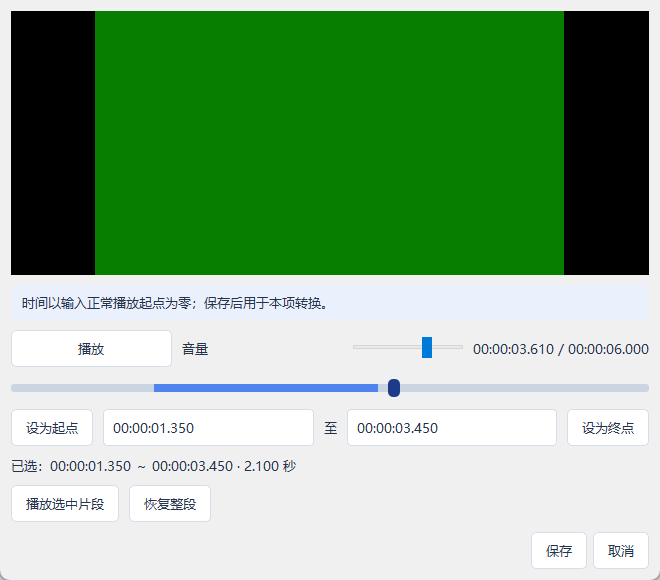

# VideoConversion

面向普通用户的 Windows 桌面视频转换器，使用 C++17、Qt 5.12.12 Widgets、libVLC 3.0.24 和 FFmpeg。当前第四版支持独立视频预览、每项一个片段、MP4/MKV、统一输出设置、串行队列、真实进度、取消和安全结果保存。

简单说：添加视频，选好画质和输出位置，开始转换；原文件保留，完成后打开目录找结果。


[首版旧布局流程演示](docs/screenshots/流程展示.gif)（由第 1 版测试截图组成，非实时录屏；当前双页签布局见上图和[日志页截图](docs/screenshots/06-converting-log.png)）。

## 使用

1. 解压 Windows 64 位包，运行 `VideoConversion.exe`，保留同目录中的 DLL、`platforms` 和 `tools`。
2. 点击“添加视频”多选文件，或把本地文件拖进窗口。目录和重复路径会提示跳过。
3. 等信息与缩略图读取结束，设置格式、画质、分辨率和输出目录；小窗口可滚动右侧设置。
4. 可选：单选一个视频，点击“预览 / 选择片段”或双击。播放、暂停、调音量；点击进度条任意位置，或按住滑块/轨道拖动，松开后定位，暂停时仍保持暂停。聚焦进度条后也可用方向键（全长 0.1%）及 PageUp/PageDown（全长 10%）定位。用当前位置设点或输入 `时:分:秒.毫秒`，点击“播放选中片段”试播，到终点暂停。
5. 点击“保存”才提交本项范围；取消、Esc 或关闭丢弃草稿。“恢复整段”也需保存。每项范围只在当前队列保留，移除重加或重启后恢复整段；成功、失败和取消项只能预览输入。
6. 点击“开始转换”。开始时固定统一设置和每项范围，运行时锁定导入、队列编辑、预览和设置，一个文件失败后继续下一项。
7. “取消当前”清理当前临时结果后继续；“停止全部”取消当前与本批待处理项。
8. 完成后点击“打开输出目录”。结果为 `原名_converted.mp4/mkv`，重名追加 `_1`、`_2` 等，不覆盖已有文件。

仅在已加载、时长已知且可定位时允许保存片段。非法时间、播放失败或播放器与探测时长相差超过 0.5 秒会显示原因，保留原已保存范围。预览打开时先保存或取消，再操作主窗口；加载超过 10 秒未完成会报错。

简单说：每个视频可以选不同的一段，格式和画质仍统一；选区要保存才用于转换。



预览失败时，先取消预览，再打开“运行日志”，搜索 `[预览]` 并点击“复制日志”。诊断包含完整输入路径、ffprobe 容器/视频/音频编码、Qt/libVLC 版本、VLC 运行时目录、文件可读性、加载状态/时长/定位能力、DLL 加载错误和 VLC 原始警告。后端文字为空会明确标注，不猜测缺少哪种解码器。每次加载最多保留 100 条底层警告并提示截断，普通播放位置不逐帧记日志，沿用现有会话日志上限。

简单说：现在“无法播放”有对应诊断，可把日志复制出来排查；系统没返回详细原因时，程序会如实说明。当前发布包已包含日志与进度条交互修复。

每项显示文件名、时长、显示分辨率、大小、编码和状态。默认窗口为 980×820，列表限制最大宽度，长文件名省略显示；将鼠标移到该项可查看完整路径、失败原因或结果路径。点击“运行日志”页签或“查看日志”查看占满主体的诊断，“复制日志”获取当前会话最近的诊断。两页共用底部进度与开始/取消/停止按钮，切换不打断转换，日志持续记录；偏好会保存，任务历史不保存。成功、失败和取消项不会自动再次运行；重试时空闲移除后重新添加。

简单说：运行时不能改这一批设置；取消一个和停止全部是两种操作。需要排查就切到日志页，看完切回转换页，任务一直继续运行。

| 设置 | 行为 |
|---|---|
| MP4 / MKV | H.264 视频；有音轨时转 AAC 128 kb/s，否则保留无音轨 |
| 高 / 标准 / 减小体积 | libx264 CRF 18 / 23 / 28，`fast` 预设；不能保证一定比原片小 |
| 原始 / 1080p / 720p | 显示方向保持比例、避免放大；编码尺寸向下对齐偶数 |
| 横屏上限 | 1920×1080 / 1280×720 |
| 竖屏上限 | 1080×1920 / 720×1280 |

完成进度不等于成功。程序等待进程正常退出，检查非空结果，再探测编码、音轨、尺寸、容器和已知时长，验证通过才不覆盖提交正式结果。失败或取消只清理本任务临时文件；清理失败会明确报告残留位置。活动工作关闭窗口时可以继续转换，或停止清理后退出。

简单说：结果检查通过才算成功。若文件被其他程序占用而删不掉，日志会告诉你位置，原文件和已有成功结果不会被删除。

## 从源码构建

本次验证环境：Windows x64、Qt 5.12.12、MinGW 7.3.0 64 位、FFmpeg/ffprobe 9.0.2 Gyan essentials。使用支持 PowerShell 脚本的终端，在仓库根目录执行：

```powershell
# 准备 FFmpeg 工具，详见 tools/README.md
./scripts/prepare_vlc.ps1
./scripts/build_release.ps1
$env:VIDEOCONVERSION_TOOLS = (Resolve-Path ./tools/bin).Path
$env:VIDEOCONVERSION_VLC = (Resolve-Path ./tools/vlc/vlc-3.0.24).Path
./build/app/release/VideoConversion.exe

# 可显式指定自己的 Qt/MinGW Kit
./scripts/build_release.ps1 -QtRoot 'D:\Qt\5.12.12\mingw73_64' -MingwRoot 'D:\Qt\Tools\mingw730_64'
```

也可在 Qt Creator 打开 `VideoConversion.pro`，选择匹配的 MinGW 64 位 Kit。开发版运行前应把对应 Qt 与 MinGW 的 `bin` 加入 PATH，或使用 Qt Creator 的运行环境。`VIDEOCONVERSION_TOOLS` 指向 FFmpeg 工具目录；`VIDEOCONVERSION_VLC` 指向含 `libvlc.dll`、`libvlccore.dll`、`plugins` 的 VLC 3.x x64 目录。发布版默认从程序旁加载 VLC，并定位旁边的 `tools`；不需要安装系统 VLC 或解码器。

简单说：源码版需要准备 Qt、FFmpeg 和 VLC 运行时；发布包把它们带齐后可以直接启动。

### Qt Creator 提示找不到 libVLC

Qt Creator 的影子构建目录与源码目录不同，qmake 编译不会自动复制第三方运行时；终端里设置的环境变量也不会自动影响已经打开的 Qt Creator。libVLC 通过 DLL 动态加载，无需在“添加库”中加入 `.lib` 或改动 `.pro`。

简单说：库已下载也不代表程序能找到它，要告诉 Qt Creator 去哪里找，或把整套依赖放到 EXE 旁。

推荐在 Qt Creator 左侧“项目 → 运行 → 运行环境”中添加以下两项，再停止并重新运行程序；只需路径，不加引号：

```text
VIDEOCONVERSION_TOOLS=D:\code\VideoConversion\tools\bin
VIDEOCONVERSION_VLC=D:\code\VideoConversion\tools\vlc\vlc-3.0.24
```

其他电脑将以上路径替换为自己的仓库位置。若 VLC 目录不存在，先在仓库根目录运行 `./scripts/prepare_vlc.ps1`，它从 VideoLAN 官方归档下载并校验 Windows x64 运行时。下载地址与指纹见 [工具说明](tools/README.md)。Qt Creator 的 64 位 Kit 必须配套 x64 VLC。

也可复制到实际 EXE 所在目录（从“项目 → 构建 → 构建目录”找到；通常为该目录的 `release` 或 `debug` 子目录），保留下面的结构。不要放到 Qt 安装目录或仅放在源码目录：

```text
release/ 或 debug/
  VideoConversion.exe
  libvlc.dll
  libvlccore.dll
  plugins/                 完整目录
  hrtfs/                   完整目录
  lua/                     完整目录
```

简单说：推荐配置运行环境，切换 Debug/Release 不必重复复制；直接双击程序则使用完整发布包，保留包中所有 DLL、插件和工具。

## 验证与打包

```powershell
./scripts/run_tests.ps1
./scripts/package_release.ps1
```

测试脚本生成可重现短素材，编译独立 Qt Test 工程，并运行真实 FFmpeg 和原生 Windows 窗口测试。结果在 `build/tests/test-results.txt`、`build/ui-tests/test-results.txt`，截图在 `docs/screenshots/`。GUI 用例会短暂打开窗口；Qt 5.12 的离屏后端未作为本次窗口验收环境。

打包脚本使用 `windeployqt` 复制 Qt 插件与运行库，附带 FFmpeg/ffprobe、VLC 3.0.24 的 DLL、完整插件/数据目录、许可证、版本和 SHA256 清单。必须先执行 `prepare_vlc.ps1`；运行时缺失或与校验清单不符时打包失败。当前产物为 `dist/VideoConversion-1.0.0-win64-revision4-timeline.zip`。已有同名包目录时拒绝复用；重打包用 `-PackageName` 指定新名称。新包验证通过后只保留最新版运行目录、运行包和源码包；历史结果仍保留在任务及构建记录。测试包和大型工具不加入 Git。

同次打包生成 `dist/VideoConversion-1.0.0-win64-revision4-timeline-source.zip`，包含工程、脚本、测试源码、说明与协作记录，排除下载工具、构建产物和合成素材；依赖和素材可由脚本准备。

当前测试范围与未验收内容见 [测试记录](docs/测试记录.md)，依赖来源见 [工具说明](tools/README.md) 和 [依赖与许可证](docs/依赖与许可证.md)。

## 工程组织与限制

- `Application`：入口、Qt Widgets 窗口与用户操作。
- `Control`：导入与队列状态、设置快照、偏好和输出文件事务。
- `Interface`：参数、媒体/进度解析、异步 QProcess、超时与取消。
- 三层各自 `.pri`，主 `.pro` 只配置单目标应用和层引用；独立测试工程复用生产代码。

仅转换第一路非封面视频与第一路音频，忽略字幕、额外音轨和附件；不支持 HDR/BT.2020 色调映射、非直角旋转、多段剪辑/拼接、逐帧编辑、无损快剪、硬件加速、并行转换或持久历史。片段使用解码后 `-ss` 和 `-t` 重新编码，截取靠后位置需要解码前面的内容，耗时可能增加。片段时长核验误差不超过 0.5 秒且严格小于目标时长的一半；毫秒输入不保证逐帧精度。

第四版预览采用 libVLC 3.0.24，保留 Qt 5.12.12 界面，使用独立 VLC 插件解码并把画面嵌入预览窗口；不再经过 DirectShow。播放支持与 FFmpeg 转换支持仍独立，无法预览时明确报错，取消后可继续整段转换。适配器只接受 VLC 3.x x64；VLC 4 的 API 不兼容，不能直接替换运行时。

简单说：预览现在使用随包的 VLC 引擎，播放暂停、音量和单片段流程仍在原 Qt 窗口中完成；具体素材兼容结果见测试记录。

输入转换格式受当前 FFmpeg 构建限制。无时长输入显示不确定进度；无法识别的特殊媒体不会获得通用兼容保证。

真实短素材与合成测试已经通过；干净电脑运行、人工播放器/画质检查和正式 GitHub/HR 交付尚待完成，不能把本机成功等同于全部交付验收。

项目方案：[整体项目开发方案](docs/确认页/项目开发/整体项目开发方案.md)。AI 协作记录只维护根目录 [会话总结.md](会话总结.md)。
