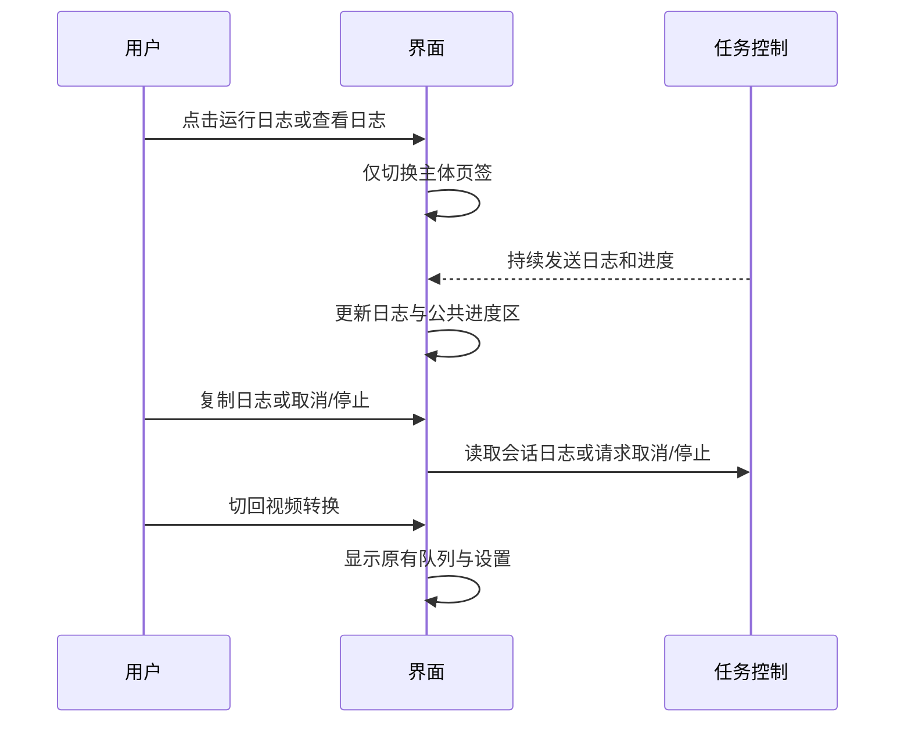
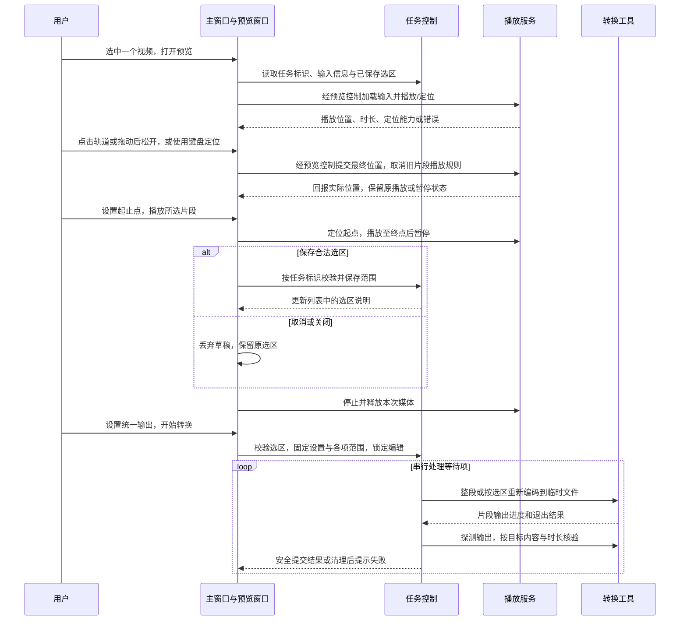
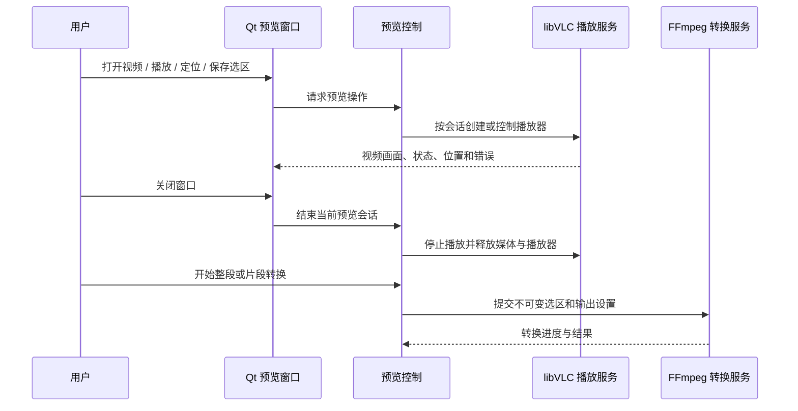
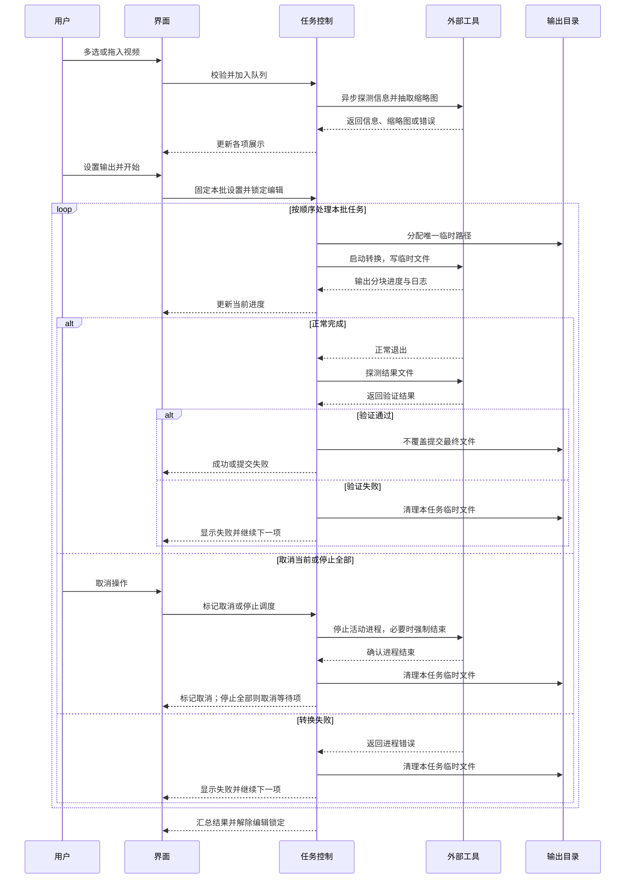

# VideoConversion 整体项目开发方案

日期：2026 年 10 月 14 日。当前修订：第 4 版（已实现，本机自动验证通过）。

- 功能与排期：用户已明确“都按你推荐的……第一版先这样定下来”，按下列十项推荐行为定案。
- 技术默认值：已按本页实施；构建及 18 组短素材真实转换通过，人工画质和跨机兼容尚待验收。
- 实现状态：第 3 版独立预览与片段转换已实现；Release 构建、格式检查、核心 55 项与原生界面 10 项通过；隔离开发路径的界面 10 项及范围/片段 11 项通过。
- 确认状态：用户已明确“我已经阅读了文档，开始改第三版”，批准本页第三版并授权实施；本机实现与自动验证已完成，独立目标机及人工验收仍待完成。
- 预览诊断补充：用户已明确要求增加日志；已接入原有日志页并通过原生 12 项、隔离依赖 12 项界面测试，更新包名为 `VideoConversion-1.0.0-win64-revision3-diagnostics`。基础第三版的核心 55 项与范围 11 项证据保留。
- 第 4 版方案：用户选择 Qt 5.12 + libVLC，随后明确“开始实施”。已接入 VLC 3.0.24 Windows x64 C ABI；三目标构建、原生 55 核心/13 界面、隔离部署 13 界面/3 用户 MP4/11 内容项全部通过。官方归档、插件、许可与画面截图已核对；人工声音/同步和独立目标机仍待验收。
- 2026 年 10 月 15 日进度交互修复已完成：点击轨道、轨道拖动与键盘定位接通；三目标构建、18 项完整界面回归及额外首尾边界用例通过。修正版在本地构建目录，既有发布包未更新；本轮未取得新增视觉、人工或独立机器验收证据。
- 同日依赖与发布跟进已完成：Qt Creator 影子构建的 Release 运行目录已补齐 VLC DLL、完整插件与数据目录；新版 `revision4-timeline` 的隔离运行 20 项、清单与归档检查通过，`dist` 仅保留最新运行目录、运行 ZIP 和源码 ZIP。旧发布产物移入回收站；长期开发环境配置方法见 README，不更改 Qt 安装或播放器接口。

## 1. 目标与范围

开发面向普通用户的 Windows 桌面视频转换器，完整展示视频导入、信息和缩略图、输出设置、串行批量转换、进度、取消及结果管理。目标是在限时笔试中同时体现客户端体验和可靠的工程处理。

简单说：别人拿到发布包，解压后能添加视频、选择输出、完成转换并找到结果；遇到错误也知道发生了什么。

采用完整轻量版：第一天功能开发完成并形成可测试包，第二天集中测试与修复，第三天核验并交付 HR。一天开发是排期目标，不是工具和环境尚未验证时的完成保证。

简单说：第一天把首版功能做齐，第二天找问题并修好，第三天拿出可交付成果。开发期间仍进行必要编译和试运行。

第 3 版在已实现的轻量版上增加视频预览及单片段转换，详见第 3.1、4.1 节。文件夹递归导入、多片段剪辑、拼接、逐帧编辑、硬件加速、并行转码、每个文件独立编码参数、托盘后台转换、持久任务历史、断点续转及内置 AI 对话仍不包含。

简单说：可以先看视频，再为每个文件选一段来转换；它仍是转换工具，不扩展成完整剪辑软件。新增功能会增加播放兼容、部署和边界测试工作，原三天排期不构成本次新增范围的完成保证。

## 2. 已定功能行为

| 功能 | 首版行为 |
|---|---|
| 导入 | 文件选择支持多选，支持拖拽文件；同一规范化路径重复添加时提示并跳过；不导入目录 |
| 信息 | 每项显示缩略图、文件名、时长、分辨率、文件大小、视频/音频编码和状态；缺失字段显示未知或无音轨 |
| 预览与片段（第 3 版） | 独立窗口播放输入视频；每个等待项保存一个选区，未设置时转换整段；列表显示整段或起止时间及片段时长 |
| 批量设置 | 一批视频统一使用输出设置；开始时取得本批设置快照，运行期间锁定设置 |
| 队列 | 按导入顺序串行转换；开始前可移除和清空，运行期间锁定导入及列表编辑 |
| 失败 | 单项失败后继续下一项；结束时汇总成功、失败和取消数量 |
| 输出 | 统一输出目录，默认名称为 `原文件名_converted.扩展名`，重名使用 `_1`、`_2` 等编号；不覆盖输入或已有结果 |
| 取消当前 | 停止当前转换及必要的结果验证，清理本任务临时输出后继续下一项 |
| 停止全部 | 先禁止调度下一项，再停止当前任务；尚未开始的本批任务标记为已取消 |
| 关闭 | 有活动任务时询问“继续转换”或“停止并退出”；选择继续则保持窗口，选择退出则等进程停止和清理完成再退出 |
| 日志与偏好 | 查看、复制当前会话详细日志；保存输出目录、格式、画质和分辨率选项，不保存队列历史 |
| 发布 | 发布包携带已验证的 FFmpeg、ffprobe、Qt 插件与匹配的运行依赖，目标是解压运行 |

上述规则保证整批行为可预测，且成功、失败和取消都有明确结果。

简单说：一次设置管这一批，坏文件不拖住其他文件；取消一个与停止全部分开；结果另存，不损坏原文件。

### 输出选项与实施默认值

| 配置 | 首版选项 | 建议默认值 |
|---|---|---|
| 输出格式 | MP4、MKV | MP4 |
| 视频编码 | 软件 H.264，建议使用 `libx264` | 所选 FFmpeg 必须实际提供该编码器 |
| 音频编码 | AAC；无音轨输入保持无音轨 | 建议 128 kb/s |
| 画质 | 高画质、标准画质、减小体积 | 标准画质 |
| 分辨率 | 保持原始、不超过 1080p、不超过 720p | 保持原始 |
| 输出目录 | 用户选择；保存最近选择 | 首次使用系统视频目录下的 `VideoConversion` 子目录；不存在时创建 |

画质与分辨率独立选择。建议 CRF 分别为 18、23、28，三档统一使用 `fast` 编码速度预设，使用 `yuv420p` 输出；MP4 增加 `faststart`。18 组参数组合已通过合成短素材转换、探测和完整解码，仍不是人工画质或性能结论。

简单说：高画质保留更多细节但通常更大；减小体积允许更多损失，但不能保证所有原片都会变小。

缩放建议保持显示比例、避免放大并满足编码器偶数尺寸要求：横向 1080p 上限框为 1920×1080，纵向为 1080×1920；720p 对应 1280×720 与 720×1280。带旋转元数据的视频应按显示方向处理；异常尺寸、比例与旋转需用实际样例确认。

建议首版转换第一路实际视频流与第一路音频流，不转换封面图、字幕、多音轨和附件；输入格式由所选 FFmpeg 能力决定。HDR、特殊色彩及不支持的输入不得承诺正确转换：探测到首版无法可靠处理的情况时明确提示限制。保持原始指分辨率策略，不代表不重新编码或原样保留所有元数据。

## 3. 界面与使用

使用简洁的浅色 Qt Widgets 单窗口，顶部提供“视频转换 / 运行日志”两个页签，底部共享当前任务、进度、开始、取消、停止、打开目录和完成汇总。转换页保留左侧视频列表与右侧统一输出设置；日志页用主体区域显示诊断，并提供复制日志。

简单说：平时在转换页操作，需要排查时切到日志页；看日志也能看到转换进度并及时停止任务。

本次调整解决两个布局限制：日志原来最多只有 140 高，设置区固定宽度导致放大窗口时列表留白增加。默认窗口改为 980×820，最低仍为 880×720；列表最大宽度为 620，保留接近原有的纵向浏览空间。长文件名在列表中省略显示，完整路径、失败原因和结果路径保留在悬停提示里。设置区仍可滚动，日志不再受 140 高限制。

简单说：窗口稍窄但不变矮，列表少一些横向空白，日志能看到更多行；文件名太长时把鼠标移上去查看。

修改集中在 Application 的窗口布局、展示和操作连接；窗口测试、使用说明、截图、任务记录及本次会话总结同步更新。日志仍由控制层持续产生，切页只改变显示页面，不重建控制器、重启转换或清空日志；复制的是原有有界会话日志。保留原有队列、编码和文件保护行为。

简单说：这是界面调整，切换页面不会打断任务；仍只保留当前会话最近的日志，不增加历史日志保存功能。

```text
┌───────────────────────────────────────────────────────┐
│ 视频转换器 [添加视频] [预览/选择片段] [移除所选] [清空] │
│ 状态提示                                  [查看日志] │
│ [视频转换] [运行日志]                                 │
├─────────────────────────────────┬─────────────────────┤
│ 视频列表                        │ 输出设置            │
│ [缩略图] 示例.mov               │ 格式：MP4 ▼         │
│ 时长 / 分辨率 / 大小            │ 画质：标准画质 ▼    │
│ 编码 / 状态 / 整段或选区        │ 分辨率：保持原始 ▼  │
│                                 │ 输出目录：[选择]    │
│ 可多选文件或拖入文件            │                     │
├─────────────────────────────────┴─────────────────────┤
│ 当前：示例.mov     [进度条] 58%     第 1 / 3 项         │
│ [取消当前] [停止全部]    [打开输出目录] [开始转换]   │
│ 完成汇总：成功 0，失败 0，取消 0                       │
└───────────────────────────────────────────────────────┘

运行日志页：
┌───────────────────────────────────────────────────────┐
│ [视频转换] [运行日志]                                 │
│ 当前会话日志                              [复制日志] │
│ 日志占满主体区域，可滚动阅读                           │
├───────────────────────────────────────────────────────┤
│ 当前任务 · 进度                                       │
│ [取消当前] [停止全部]    [打开输出目录] [开始转换]   │
│ 完成汇总                                             │
└───────────────────────────────────────────────────────┘
```

使用“运行日志”页签或状态提示旁的“查看日志”进入日志页，再切回“视频转换”继续查看列表。两页都保留状态和进度；错误不会强制切页。日志页支持选择、滚动和复制，仍有原来的条数/字符保留上限。风险是列表与完整日志需要切换查看，较窄窗口会省略更多长文件名；验证会覆盖最小尺寸、长文件名和转换期间切页。

简单说：日志空间更大，但需要切页查看列表；程序不会因为出错突然把你带离当前页面。



添加后逐项异步读取信息和缩略图；缩略图失败使用占位图和提示，不让整个程序卡住。信息探测成功且存在可转换视频流才可参与转换。存在未完成探测时暂不开始；探测失败项单独显示原因，其他有效项仍可转换。

开始后禁用添加、移除、清空和输出设置，启用适用的取消按钮。转换结束后恢复编辑，显示汇总并保留本次结果状态。建议再次开始时只处理等待项，成功、失败及取消项不自动重复运行；需要重试时在空闲状态移除该项后重新添加，不额外实现重试面板。

简单说：先等信息读完再开始，运行时避免改动这一批；完成后能检查每个文件的结果，重试用重新添加的方式完成。

未知时长使用不确定进度条；已知时长显示真实进度，结果验证与文件提交完成前不宣告成功。首版只承诺当前任务进度和批次项数，不增加预计剩余时间或精确的总体时间进度。

### 3.1 视频预览与片段转换（第 3 版已实现）

采用独立模态预览窗口，针对一个已读取信息的输入视频播放和编辑选区；主界面继续保留转换、日志两个页签。主界面恰好选中一个有效视频且批次空闲时，启用“预览 / 选择片段”，多选时提示先选择一个文件；双击单项也可进入。成功、失败或取消的终态项可预览原视频，但不能编辑选区或因此重新加入转换批次。读取失败或原文件不可访问时提示原因。

简单说：选一个视频打开预览，主界面不会被播放器挤小；已完成的项目只能查看，重试仍要移除后重新添加。

```text
┌────────────── 视频预览：示例.mov ──────────────┐
│                                              │
│                   视频画面                   │
│                                              │
├──────────────────────────────────────────────┤
│ [播放/暂停] [音量] ──●── 00:10 / 02:00       │
│ [设为起点]                     [设为终点]    │
│ 起点 [00:10.000]   终点 [00:35.000]           │
│ 已选时长：25.000 秒                          │
│ [播放选中片段] [恢复整段]                    │
│                              [取消] [保存]  │
└──────────────────────────────────────────────┘
```

支持带声音播放、暂停、音量调节和拖动定位；无音轨视频照常播放。起止点可以取当前播放位置，也可输入 `时:分:秒.毫秒`，播放器进度条显示选区标记。时间以输入视频的正常播放起点为零，毫秒输入是定位精度，不承诺逐帧编辑精度。默认选区为整段；选中片段播放从起点开始，到终点暂停，不自动循环或触发转换。

简单说：边看边点起点、终点，或者直接填时间；先播放所选部分，满意后再保存。

2026 年 10 月 15 日进度交互修复：旧代码仅监听滑块松开信号，轨道点击采用 Qt 默认翻页行为，键盘变更也未提交播放器定位；真实鼠标测试确认直接拖住滑块可用，轨道点击和键盘定位失败。修复限定于 Application 预览控件及对应测试：轨道左键点击直接选择位置，也可从任意轨道位置开始拖动，松开提交最终位置；键盘及滚轮变更提交定位，后端刷新阻断信号以避免反馈循环。拖动期间仍隔离播放位置刷新，定位沿用原有控制器取消片段自动暂停规则，不自动保存选区。点击区域高度至少 24 像素；方向键步长为全长的 0.1%，PageUp/PageDown 为 10%。风险为样式尺寸换算、首尾边界与异步播放状态，需通过真实后端测试验证；现有时长和能力限制继续适用。

简单说：可以点进度条任意位置，也可以按住拖动，松开就跳到那里；暂停时跳转仍保持暂停。选好播放位置后，仍需点“设为起点 / 终点”和“保存”才能更改转换片段。

开发运行与发布依赖：Qt Creator 使用项目外的影子构建目录，qmake 不会自动部署 libVLC；原运行配置缺少 `VIDEOCONVERSION_VLC`，因此虽然仓库中已有运行时，预览仍提示缺失。长期推荐在“项目 → 运行 → 运行环境”填写 FFmpeg/VLC 绝对目录；本次直接向实际 Release EXE 旁补齐 VLC 3.0.24 x64 DLL、完整 `plugins`、`hrtfs`、`lua`，停止旧程序并重新运行即可加载。源码与播放接口不变。当前发布使用 `VideoConversion-1.0.0-win64-revision4-timeline` 名称，已验证并仅保留最新版运行目录、运行 ZIP 和源码 ZIP；旧包移入系统回收站，历史验证记录仍保留在构建与任务记录。

简单说：Qt Creator 能编译不等于运行依赖齐全。开发时配置路径，或把整套 VLC 放到 EXE 旁；交给别人则使用已带齐依赖的新包。新包检查通过再删除旧包，避免留下多个版本用错。

仅对已知时长且支持定位的视频启用片段编辑，满足 `0 ≤ 起点 < 终点 ≤ 输入时长` 才能保存。非法输入保留原已保存选区，显示原因并禁用保存；“恢复整段”清除草稿选区，保存后才生效。关闭窗口、按 Esc 或取消均丢弃本次草稿，保留上一次保存的范围。未知时长或无法定位时提示限制，仍可使用可用的播放能力与整段转换；播放器播放失败时禁用依赖播放的操作，也不新保存片段。

简单说：时间填错不会悄悄换成整段；没点保存就不改变任务。某些视频能转换却不能预览，程序会明确说明。

每项选区仅在当前队列中保存，移除、清空或重新启动程序后不保留；不写入统一输出偏好，不应用到其他视频。主列表显示“整段”或起止时间与片段时长，完整时间同时保留在提示中。选区只决定截取内容，MP4/MKV、画质、分辨率和输出目录仍统一设置；整段和片段沿用 `_converted` 名称及重名编号规则。

简单说：A 视频选 10～35 秒，B 视频仍可整段转换；切换选择或日志页不会把 A 的范围带给 B。

预览窗口打开时主窗口不可启动转换、移除项或退出；先保存或取消预览，再操作主窗口。关闭预览须停止播放并释放媒体资源。批次运行期间禁用预览入口和选区修改，控制层也拒绝修改；开始时校验所有待转换项的已保存选区并取得本批快照，校验失败则提示对应文件且不启动这一批。输出进度与结果核验以选中片段时长为准，整段保持原有逻辑。

简单说：先选好再转换，转换途中不能改这一批的范围；截取 25 秒，就按这 25 秒显示进度和检查结果。



### 3.2 预期效果与范围取舍

第 3 版预期将“先在其他软件裁剪，再导入转换”合并为“导入、预览、保存片段、转换”。例如两分钟视频选择 10～35 秒，输出应包含该段约 25 秒的画面及对应声音，而非完整视频或起点错误的另一段；恢复整段后输出仍为完整内容。最终长度受视频帧及音频采样边界影响，应通过内容标记、时长、完整解码及人工音画检查共同验收。

简单说：选哪里就转哪里，不能只看结果是 25 秒就认为截对了。

推荐方案已由用户选定：独立预览窗口、每项一段，主窗口布局影响较小，使用流程完整。主界面内嵌播放器不采用，因为会挤占现有列表和设置空间；多片段、拼接、逐帧编辑及无损快速裁剪不纳入本次范围，避免增加编辑和关键帧边界的复杂度。

简单说：先把“看、选、转”做可靠，后续再考虑完整剪辑功能。

## 4. 技术方案与模块职责

实际采用 Qt 5.12.12、Qt Widgets、C++17、qmake，使用已验证的 MinGW 7.3 64 位 Kit。QProcess 异步管理外部工具；不为已经独立运行的 FFmpeg 再增加无必要的线程。Qt Test 用于关键逻辑与状态边界。

简单说：Qt 负责桌面交互，FFmpeg 负责视频处理，用事件通知保持界面响应。

| 层 | 职责与建议文件 |
|---|---|
| Application | `main.cpp` 装配对象；`main_window.h/.cpp/.ui` 处理界面与用户操作；`Application.pri` 登记本层资源 |
| Control | `conversion_controller.h/.cpp` 管理导入、队列、状态与设置快照；`conversion_types.h` 定义任务与设置；`output_file_manager.h/.cpp` 管理命名、临时文件与提交；`settings_store.h/.cpp` 管理偏好 |
| Interface | `ffmpeg_service.h/.cpp` 封装进程、工具校验、探测、抽帧和转换；`ffmpeg_arguments.h/.cpp` 构造参数；`progress_parser.h/.cpp` 处理分块输出；`media_types.h` 定义解析结果 |
| tests | 单独 Qt Test 工程，复用受测生产文件，不并入桌面主程序 |
| scripts / tools | PowerShell 构建打包脚本；本地 FFmpeg 工具与来源说明；大型运行组件是否上传按实际体积处理 |

主 `VideoConversion.pro` 仅放工程配置并引入三层 `.pri`。依赖向下：Application → Control → Interface；入口装配可直接构造底层对象，窗口业务操作通过 Control。各层 `.pri` 不互相引入。所有 Qt 类头文件正确登记以供 moc，界面与资源登记供 uic/rcc。

遵循用户代码读取验证原则与 Qt/C++ 技能附带的编码、分层规范；文件命名、具名命名空间、所有权、中文自然注释及函数体阶段覆盖均需检查。新增格式化配置如有需要以所读规范为基线，不对无关文件作批量格式化。

### 4.1 第 3 版新增模块与兼容策略（已实现）

第三版诊断补充由用户“帮我增加对应日志，辅助查看因为什么无法打开”授权：将预览文件路径、ffprobe 信息、加载状态/能力、错误名称/编号/原始文字、超时与 Qt 播放后端警告接入已有有界会话日志。来自工作线程的后端消息排队回 GUI 线程，按会话代次丢弃过期通知，状态变化时才记日志。保留原 Qt 消息处理器，不修改解码器或转换规则；后端未给具体原因时如实标明。

简单说：遇到无法播放，取消预览后打开“运行日志”并复制，即可查看文件、错误码及底层警告；日志帮助定位问题，不保证系统一定返回完整原因。

当前第四版使用 libVLC 3.0.24，Application 负责原生 QWidget 视频表面与 Qt 操作控件，Control 管理会话、片段播放边界和选区业务，Interface 封装 libVLC 加载、播放、定位、轮询状态与有界原生日志。第三版的 QMediaPlayer / DirectShow 实现已替换。转换仍使用现有 FFmpeg 外部进程重新编码，不先导出中间裁剪文件；Control 不操作 QWidget。

简单说：播放器负责让人看视频，现有转换链负责输出结果；两条链路各有负责人，不互相抢用转换进程。

新增 `preview_dialog.h/.cpp/.ui`、`preview_controller.h/.cpp`、`media_playback_service.h/.cpp` 和底层时间范围值类型，分别登记对应 `.pri`；更新入口装配、主窗口入口及选区展示、队列数据和批次快照、转换参数、片段进度、结果验证及相关测试。实际命名可在职责不变的前提下细化。主 `.pro` 增加匹配 Qt 模块，打包脚本补充部署播放插件和运行库，依赖说明在实现后按实物更新。

简单说：这次需要修改三层代码及播放依赖，不只是加一个按钮；若少改进度和结果校验，短片段可能被误判为转换失败。

历史第三版 DirectShow 可播放/定位 MJPEG/PCM AVI、WMV2/WMA，但本机 H.264/AAC MP4 报 `ResourceError` / `0x80040266`；这促成第四版替换。当前 libVLC 验证结果见测试记录。不能预览时明确报错，取消后可整段转换，不自动清除已有范围。加载超时仍为 10 秒；未知时长、不可定位或播放器与探测时长相差超过 0.5 秒时禁止片段保存。人工听音/同步和独立目标机仍待验收。

简单说：当前由 VLC 负责预览；遇到不能播的素材仍明确说明，不要求用户盲目安装解码器。

片段范围使用明确的启用标志与整数毫秒，原始媒体信息保持不变；FFmpeg 使用 `-i` 后的输出端 `-ss`、`-t` 解码后截取并重新编码，输出时间归零。非关键帧、非零起始时间、开头/中间/末尾、200 毫秒、无音轨及 MP4/MKV 已通过画面颜色与声音频率标记验证。输入端快速定位曾让无索引长 GOP 的 TS 丢失前滚参考帧，改为解码后截取解决；代价是靠后截取需解码前面的内容，耗时可能增加。结果验证使用目标时长，片段允许误差不超过 0.5 秒且严格小于片段时长的一半，整段保留原规则。

简单说：原视频有多长还是多长，另记要转换哪一段；检查短片段时不能随便容许差两秒。

### 4.2 第 4 版预览后端调整（已授权实施）

用户已选择保留本地 Qt 5.12，改用 libVLC 承担应用内预览。原因是当前 Qt Multimedia 的 DirectShow 播放服务无法播放用户的 H.264/AAC MP4（日志为 `ResourceError`、`0x80040266`），而 Windows 自带播放器可以打开；这是应用当前后端兼容差异，不是 FFmpeg 转换失败，也没有证据表明系统播放器无法启动。第 4 版只替换预览播放引擎，不改转换引擎和选区语义。

简单说：问题出在程序内置预览所用的 DirectShow 路径；现在换成 libVLC，继续用 FFmpeg 转换，并保留现在的预览与片段操作。

保留 Qt 5.12.12 / MinGW 7.3 x64、Widgets 界面、独立模态预览、任务选区及现有 FFmpeg/ffprobe 链路。预览窗口的视频画面改由 libVLC 渲染至 Qt 窗口句柄；Control 层继续掌管预览会话、能力判断和片段边界，Interface 层封装 libVLC 实例/媒体/播放器对象的创建、播放、暂停、定位、音量、事件通知和释放。应用退出或窗口关闭时先停止并释放播放器、媒体和 VLC 实例；新旧会话仍以代次隔离。转换仍由现有异步 FFmpeg 进程完成。

简单说：Qt 窗口和片段流程不变，视频画面改由 VLC 绘制；关窗时按顺序停掉并释放 VLC 资源。

实际采用 VLC 3.0.24 win64，通过 Windows 动态加载 C API，按对应源码头文件核对签名和回调清理约定，绕开 MSVC/MinGW 专用导入库差异。运行时和源码归档已对照官方 SHA256 校验；VLC 从 DLL 旁自动发现完整 plugins，已废弃的 `--plugin-path` 参数不再使用。`prepare_vlc.ps1` 准备依赖、许可和逐文件指纹，打包脚本发现组件缺失或改变即失败。核心 LGPL 与完整插件中的 GPL 组件分别保留许可全文和源码地址；Qt 仍为 5.12，不安装系统解码器。

简单说：使用能与现有 Qt/MinGW 一起运行的 VLC DLL，把插件和许可材料完整带上，缺依赖就不能生成发布包。

验收至少覆盖用户提供的 H.264/AAC MP4、实际声音输出与静音/无音轨、播放暂停、定位、片段起止播放、重复开关窗口及正在加载时关闭、文件占用释放、错误日志、整段/片段转换不回归，以及不依赖开发机 VLC/Qt 路径的部署运行。具体 MP4 和隔离包通过前，只能描述为“已接入待验证”，不得承诺普遍兼容或等同 Windows 自带播放器。Qt 5.12 与 VLC 插件组合仍可能受编解码组件、音频输出模块、CPU 架构和许可证分发方式影响；FFmpeg 转换支持范围继续独立于预览支持范围。

简单说：拿用户这类 MP4 和不带开发环境的发布包实测后，才能确认是否解决；其他格式也不因此保证都能播。



## 5. 状态、资源与文件策略

控制层持有队列和本批设置，Interface 持有实际 QProcess；所有 QObject 明确 parent 或所有者。进程使用程序路径与参数列表启动，不拼 shell 命令，不在 GUI 线程同步等待。信息探测/抽帧采用有界串行处理，避免一次导入启动大量进程。

简单说：任务和进程都有负责人，同一时间只转换一个文件，点击取消或退出后不能留下无人管理的转换进程。

建议状态为：读取信息 → 等待转换 → 转换中 → 验证结果 → 成功；错误进入失败；取消先进入取消中，实际停止及清理后进入已取消。批次另有空闲、运行中、停止中，防止任务结束回调意外启动下一项。

每次任务绑定唯一标识和运行代次；过期回调忽略，终态只报告一次。取消/超时先停止调度，异步请求停止，再在有限等待后强制结束；只有停止回调确认后清理输出。对探测、抽帧、结果探测设置有限超时；转换不设置短固定总时长限制。建议探测和抽帧各 15 秒、结果探测 20 秒、取消升级等待 2 秒，实际可按样例调整。

转换写入输出目录内唯一的临时文件，保留正确容器后缀或显式指定格式；不使用最终路径直接写入。成功后检查正常退出、文件非空，并用 ffprobe 检查编码、尺寸、音轨与时长；验证通过后以不覆盖方式重命名为最终路径。提交时再次检查重名，遇竞争重新分配名称，不能覆盖。

简单说：完成前只有临时文件，验证通过才变为正式结果；失败或取消只删除本任务的临时文件。

若临时文件清理失败，显示残留位置，不覆盖原始错误。已提交的成功文件不因后续取消或批次失败删除。进度输出按完整行与完整记录解析，保留跨回调残片；完成标记或 100% 不单独作为成功依据。



## 6. 三天实施安排

| 时间 | 工作 | 完成门槛 |
|---|---|---|
| 第一天前段 | 验证 Kit、FFmpeg 能力；建立工程与窗口；检查最小部署 | 编译可运行，工具可调用，依赖来源明确 |
| 第一天中段 | 信息、缩略图、转换参数、单文件转换、进度、取消、文件保护 | 单文件闭环真实运行，关键状态可观察 |
| 第一天下半段 | 串行队列、失败继续、停止全部、关闭处理、偏好、日志、界面样式与打包 | 首版全部功能齐备，可测试发布包；停止增加新功能 |
| 第二天 | 真实视频与异常行为测试、缺陷修复、受影响行为复测、发布环境运行 | 测试有实际证据，交付阻断缺陷解决或明确披露 |
| 第三天 | 最终包与 GitHub 内容核验、README/截图/演示/测试记录、交付 | 提供可获取源码与可运行包，以及明确使用说明 |

实现细节变动可在既定功能边界内处理；若必须削减已定功能、更换技术栈或增加明显新范围，应先说明对结果和排期的影响，由用户选择。测试日可修复缺陷，不能视为所有代码必须第一天之后完全不变。

## 7. 验收与交付

验收同时检查用户操作、真实 FFmpeg 输出及发布环境。测试使用可重现的素材特征和预期结果，自动测试重点覆盖参数、进度分块、队列及取消的状态边界。

简单说：不仅程序能编译，还要确认输出是真视频、能播放、取消真的停了，别人电脑上的发布包也能启动。

| 类别 | 验收要求 |
|---|---|
| 导入展示 | 多选、拖拽、重复、中文空格路径；信息和缩略图；损坏/无视频输入不会卡住 |
| 输出组合 | 两种容器、三种画质、三种分辨率共 18 组参数组合；用短样例检查，不把未测组合写成通过 |
| 视频边界 | 无音轨、低分辨率、竖屏/旋转、奇数尺寸、未知时长；不支持情况提示清楚 |
| 结果验证 | ffprobe 检查 H.264/AAC、容器、分辨率和时长；重要样例实际播放确认 |
| 第 3 版预览 | 带声音/无音轨播放、暂停、音量、拖动、竖屏/旋转、中文空格路径、加载失败和不可定位提示；默认/最小窗口及高 DPI |
| 第 3 版选区 | 当前播放位置设点、手填毫秒、合法边界/非法时间、恢复整段、保存/取消、任务间隔离、不持久化、终态只读与运行中锁定 |
| 第 3 版片段结果 | 开头/中间/末尾及短片段，MP4/MKV、有/无音轨、非关键帧起点和非零时间戳；核对画面/声音标记、目标时长、完整解码及音画同步 |
| 第 3 版生命周期与部署 | 重复开关预览不串回调或占用文件；关闭释放资源；片段取消/停止/关闭仍保护文件；发布包播放模块、插件和声音/定位实际验证 |
| 文件保护 | 源文件、已有结果、同名输入、重名竞争、不可写目录；失败/取消无误删 |
| 队列与生命周期 | 失败继续、取消当前继续、停止全部、重复点击、取消临近完成、转换中关闭、过期回调 |
| 工具异常 | FFmpeg/ffprobe 缺失、无法启动、编码器不支持、探测超时；提示可理解且状态恢复 |
| 部署 | 在无 Qt 开发环境的目标环境运行，确认 Qt 插件、编译器运行库、工具及许可证说明齐全 |

交付内容：源码与 qmake 工程、README、截图、Windows 压缩包、简短演示、真实测试记录，以及唯一持续更新的《会话总结.md》。会话总结记录 AI 建议、开发者决定和反馈，不另建多份会话总结。

发布脚本使用所选 Kit 的 `windeployqt`，复制已验证的 FFmpeg/ffprobe，记录实际版本、来源、构建能力和对应许可证。具体下载与 GitHub 上传在执行阶段按实际来源和体积处理；不假定已安装或已发布。

## 8. 风险与尚待验证事项

- Qt/MinGW、FFmpeg 编码器与本机依赖隔离已验证，独立干净目标环境仍需验收。
- CRF 和速度预设是初值，需要通过第二天样例确定画质、体积与耗时是否合理。
- 发布包脱离开发环境的验证需要实际目标机器或干净环境；未做时明确记为未验证。
- 首版不保证所有损坏、加密、多流、HDR 或特殊视频都能正确转换，不能以一次成功推断所有格式支持。
- 当前系统 DirectShow 的 H.264/AAC MP4 预览已复现失败；AVI/WMV 播放和定位已验证。毫秒输入不保证逐帧定位，真实摄像素材的时间戳、人工声音/同步、旋转预览及高 DPI 仍需验收。
- 第 3 版有范围事务、内容/频率、进度、取消/停止/关闭和本机部署证据；未知时长、不可定位及旧代次的预览规则部分使用显式模拟，不作为对应真实媒体兼容证据。
- 第三天交付是用户目标；本轮提供本地首版与测试包，未创建提交、推送、公开发布或向 HR 发送消息。

第三版保留主窗口 980×820、最低 880×720 和独立日志页签，新增默认 780×660、最低 660×580 的模态预览。构建、核心 55 项、界面 10 项通过，隔离开发路径的界面 10 项与范围/片段 11 项通过；预览横竖屏截图已检查。详见 [使用与构建](../../../README.md)、[测试记录](../../测试记录.md) 和 [依赖与许可证](../../依赖与许可证.md)。新压缩包为 `VideoConversion-1.0.0-win64-revision3.zip`，旧 GIF 保留为第一版截图演示。高 DPI、独立目标机、人工听音/同步/画质与外部交付尚待完成。

简单说：现在已有可运行、可测试的首版；第二天仍需用真实素材和另一台电脑验收，再准备正式交付。

第 3 版按已阅读批准的范围实现，没有创建 Git 提交、推送、公开发布或联系 HR；任务保持验证状态，未将缺少的人工和独立目标机验收写成完成或归档。

简单说：现在可打开第三版测试预览和片段转换；本机自动检查通过，正式交付仍需真人和另一台电脑检查。
